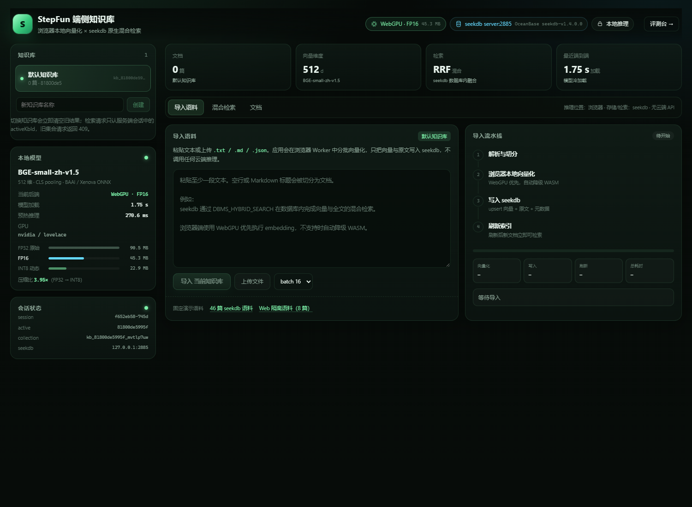

# StepFun · 端侧推理与 seekdb 混合检索

浏览器本地完成文档/查询向量化，使用 **seekdb 原生 `DBMS_HYBRID_SEARCH`** 完成向量 + 全文混合检索的迷你知识库。推理全程在用户设备上执行，不调用任何云端推理 API。

- **前端**：React 19 + Vite 8 + Transformers.js 3.8.1（ONNX Runtime Web）
- **端侧模型**：BAAI/bge-small-zh-v1.5（512 维），INT8 / FP16 量化
- **后端**：Node.js + Express 5 + [seekdb-js](https://github.com/oceanbase/seekdb-js) 1.4.0
- **数据库**：seekdb 1.4.0，`HNSW` 向量索引 + `IK` 全文索引，混合检索在数据库内用 RRF 融合
- **浏览器**：Chrome / Edge 最新版（WebGPU 优先，自动降级 WASM）



## 快速开始（已验证路径：Windows Chrome + WSL2 后端）

### 0. 环境

- Node.js ≥ 20（本项目实测 Node 22.20）
- Chrome / Edge 最新版（实测 Chrome 156）
- seekdb 1.4.0：使用独立端口 **2885** 与独立数据目录，不依赖任何已有 seekdb 实例
- 后端建议运行在 Ubuntu 24.04 / WSL2；浏览器可运行在 Windows

### 1. 启动 seekdb server（首次会下载官方 .deb，约 240 MB）

```bash
# 在 WSL2 / Ubuntu 24.04 中，仓库根目录为 stepfun/
bash scripts/start-seekdb.sh
# 输出: seekdb listening on 2885
```

脚本从 OceanBase 官方 GitHub Release 下载 `seekdb_1.4.0-...ubuntu24.04_amd64.deb`，解压到 `~/.stepfun/seekdb-server/`，以当前用户启动，数据放在 `~/.stepfun/seekdb-server/runtime/`。
停止：`bash scripts/start-seekdb.sh stop`。若 GitHub 下载慢，可用 `SEEKDB_DEB_URL=<镜像 URL>` 覆盖。

> 已存在 2881 端口上的 seekdb 不会受影响；本应用只连接 2885。
> 也可以不启动 server，直接使用 SDK 的嵌入式模式（不设置 `SEEKDB_HOST`），但本提交的验收数据来自 server 模式。

### 2. 安装依赖并启动应用

```bash
# 在 stepfun/ 目录
npm install --ignore-scripts
```

`--ignore-scripts` 跳过 `onnxruntime-node` 的原生二进制下载；浏览器使用打包进前端的 `onnxruntime-web`，不需要 Node 原生推理。
`npm run build` 会先把 ONNX Runtime Web 的 `.mjs/.wasm` 运行时复制到 `public/ort/`，应用运行时不再访问 jsDelivr 等外部 CDN。
（`.npmrc` 已设置 `legacy-peer-deps=true`，用于避开 `@seekdb/default-embed` 的 workspace peer 声明问题；本项目不使用该包。）

```bash
# 生产构建 + 单端口（Express 同时服务 API、模型与前端）
npm run build
SEEKDB_HOST=127.0.0.1 SEEKDB_PORT=2885 SEEKDB_DATABASE=stepfun PORT=8788 npm start
# 打开 http://localhost:8788
```

开发模式（Vite 5174 + API 8788，前端代理到后端）：

```bash
SEEKDB_HOST=127.0.0.1 SEEKDB_PORT=2885 SEEKDB_DATABASE=stepfun npm run dev
# 打开 http://localhost:5174
```

### 3. 演示流程

1. 等待右上角出现 `WebGPU · FP16` 或 `WASM · INT8` 徽标（模型加载完成）。
2. 左侧新建知识库（或使用默认库）。
3. “导入语料”页 → 点击“46 篇 seekdb 语料” → 观察 向量化 → 写入 seekdb → 刷新索引 的分阶段耗时。
4. “混合检索”页输入问题，比较 混合 / 向量 / 全文 三种模式。
5. 新建第二个知识库并导入“Web 隔离语料”，切换回来验证结果只来自当前集合。
6. 打开 `/bench` 运行固定评测（46 篇 / 24 查询），导出 JSON。

## 验收要点对应

| 题目要求 | 实现位置 |
| --- | --- |
| 文本导入 → 本地向量化 → 写入 seekdb | `src/embedding/worker.ts`、`src/App.tsx`、`server/db.ts` |
| 查询本地向量化 + seekdb 混合检索 | 查询在 Worker 内编码；`collection.hybridSearch` 调用数据库存储过程 |
| 混合检索不由客户端拼合 | 只调用一次 `hybridSearch`，返回 `DBMS_HYBRID_SEARCH` 的单一排序结果 |
| INT8 / FP16 量化、来源与体积 | `models/bge-small-zh-v1.5/README.md`、`scripts/quantize_embedding.py`、`model-manifest.json` |
| WebGPU 优先、WASM 自动降级、界面提示 | `src/embedding/worker.ts`、`StatusBadges.tsx`、`Sidebar.tsx` |
| 向量、原文、文档 ID 存 seekdb | 集合表 `id/document/embedding/metadata`；元数据含 `kbId`、标题、来源、块号 |
| 增量导入、索引刷新 | 稳定文档 ID + `upsert`；`collection.refresh_index()` |
| 集合与会话状态、切换隔离 | 服务端 session `activeKbId`；旧 `expectedKbId` 请求返回 `409 KB_CHANGED`；集合名含创建 epoch |
| Chrome/Edge 可复现 | 见上；`scripts/api-test.mjs` 与 `tests/` 下的 Playwright 脚本 |

## 架构

```
┌──────────────── Browser (Chrome / Edge) ────────────────┐
│  React UI                                               │
│    │ 文本 / 查询                                         │
│    ▼                                                    │
│  Web Worker                                             │
│    Transformers.js 3.8.1 → ONNX Runtime Web             │
│    WebGPU(FP16) ──失败/不支持──▶ WASM(INT8)              │
│    CLS pooling + L2 normalize + BGE query instruction   │
│    │ 向量                                               │
│    ▼                                                    │
│  fetch /api/...  (向量 + 原文 + 元数据)                   │
└─────────────────────────┬───────────────────────────────┘
                          │ HTTP (same origin)
┌─────────────────────────▼───────────────────────────────┐
│  Node / Express (8788)                                  │
│    session(activeKbId) · KB registry · import · search  │
│    seekdb-js 1.4.0                                      │
│         │                                                │
│         ▼                                                │
│  seekdb 1.4.0 (127.0.0.1:2885, 独立数据目录)             │
│    collection table: id / document / embedding / metadata│
│    HNSW cosine index + FULLTEXT IK index                 │
│    DBMS_HYBRID_SEARCH(fulltext + knn, RRF)               │
└─────────────────────────────────────────────────────────┘
```

## seekdb 数据与索引配置

每个知识库对应一个集合（表名由 SDK 生成 `c$v2$<collection_id>`），创建参数（`server/db.ts`）：

```ts
new Schema({
  fulltextIndex: new FulltextIndexConfig("ik", { ik_mode: "smart" }),
  vectorIndex: new VectorIndexConfig({
    hnsw: { dimension: 512, distance: "cosine", m: 16, ef_construction: 200 },
    embeddingFunction: null, // 向量由浏览器生成，DB 不做云端 embedding
  }),
});
```

- 写入：`collection.upsert({ ids, documents, embeddings, metadatas })`；ID 由浏览器对内容生成稳定 SHA-256，重复导入覆盖而不新增。
- 刷新：`collection.refresh_index()` → `CALL dbms_index_manager.refresh()`；UI 显示耗时。
- 混合检索：`collection.hybridSearch({ query: { whereDocument: { $contains } }, knn: { queryEmbeddings }, rank: { rrf } })`，数据库返回融合后的单一列表；客户端不做两路拼接。
- 全文查询会做 Lucene 特殊字符清洗；清洗后为空时回退到纯向量，防止查询报错。

## 会话 / 集合状态

- 浏览器持有 HttpOnly `stepfun_sid`；服务端会话记录 `activeKbId`。
- 所有 KB 级 API 同时校验 URL 中的 KB 与可选 `expectedKbId`；与当前 `activeKbId` 不一致返回 **409 KB_CHANGED**。
- 前端切换知识库时立即清空检索结果、中止正在进行的导入；旧查询结果不会渲染。
- 集合名包含 6 字节随机 ID + 创建时间 epoch，删除/重建不会复用旧表名。
- 每条文档元数据由服务端写入 `kbId` / `collection`，可在检索结果中直接核对来源。

## 模型与量化

见 [models/bge-small-zh-v1.5/README.md](models/bge-small-zh-v1.5/README.md) 与 `model-manifest.json`。

| 精度 | 文件 | 体积 | 压缩比 |
| --- | --- | ---: | ---: |
| FP32 | `model.onnx`（按需下载） | 94,851,877 B | 1.00× |
| FP16 | `model_fp16.onnx` | 47,497,427 B | 2.00× |
| INT8 | `model_quantized.onnx` | 24,011,364 B | 3.95× |

量化由本仓库脚本生成（onnxruntime 1.23.2 动态量化 / FP16 转换），INT8 脚本内置 CPU 推理校验；质量与性能对比见 `TECH_NOTE.md` / `BENCHMARK.md`。

## 验证与评测

```bash
# API：增量导入、索引刷新、三种检索、切换隔离、409 守卫、维度校验（20 项）
BASE_URL=http://127.0.0.1:8788 node scripts/api-test.mjs

# 浏览器评测台（Playwright + 系统 Chrome；可 WebGPU/WASM、批大小、刷新策略）
node tests/e2e.mjs          # 完整 UI 流程 + 截图
node tests/bench.mjs        # 性能/质量矩阵（默认 9 项）
node tests/fallback.mjs     # 禁用 WebGPU 验证自动降级
node tests/network.mjs      # 验证模型/ORT 运行时全部来自本机，无外部请求
```

评测使用固定的 46 篇中文语料（`data/corpus/kb-seekdb.json`）与 24 条带标签查询（`data/queries.json`）；原始结果在 `evidence/`。

## 目录

```
stepfun/
  server/                  Express API、seekdb 访问、会话
  src/                     React UI、Embedding Worker、评测台
  models/bge-small-zh-v1.5 模型、tokenizer、量化产物、manifest
  data/corpus/             固定语料 + 第二知识库（隔离测试）
  data/queries.json        固定查询与 relevant 标签
  scripts/                 seekdb 启动、模型下载/量化、API 测试、开发启动
  tests/                   Playwright E2E / bench / fallback
  evidence/                截图、原始 JSON、服务日志
  README.md / TECH_NOTE.md / BENCHMARK.md
```

## 已知限制

- 本提交的性能/质量数据来自 **Windows 11 + Chrome 156 + WSL2 Ubuntu 24.04**，seekdb 以 server 模式运行在 WSL 的独立端口 2885；跨 WSL 回环会引入约 30–50 ms 的 HTTP 往返，端到端延迟含该开销。
- 首次模型加载包含本地 23/45 MB 权重读取、ONNX 初始化与 GPU 内核编译；浏览器 Cache API 预热后重载显著变快（见评测矩阵）。
- WebGPU 的可用性取决于浏览器与显卡驱动；不可用时自动加载 WASM/INT8，核心流程仍可用。
- ONNX Runtime Web 的 WASM 运行时由 `npm run build` 从依赖包复制到 `public/ort/`，不依赖外部 CDN；`tests/network.mjs` 验证运行期零外部请求。
- 嵌入式模式（不设置 `SEEKDB_HOST`）由 seekdb-js 原生绑定提供，Windows/Linux 均支持；本轮验收使用 server 模式，嵌入式未纳入性能矩阵。
- 质量指标基于 24 条人工标注查询，样本规模有限；标签在测量前固定，不使用模型输出反向构造。
